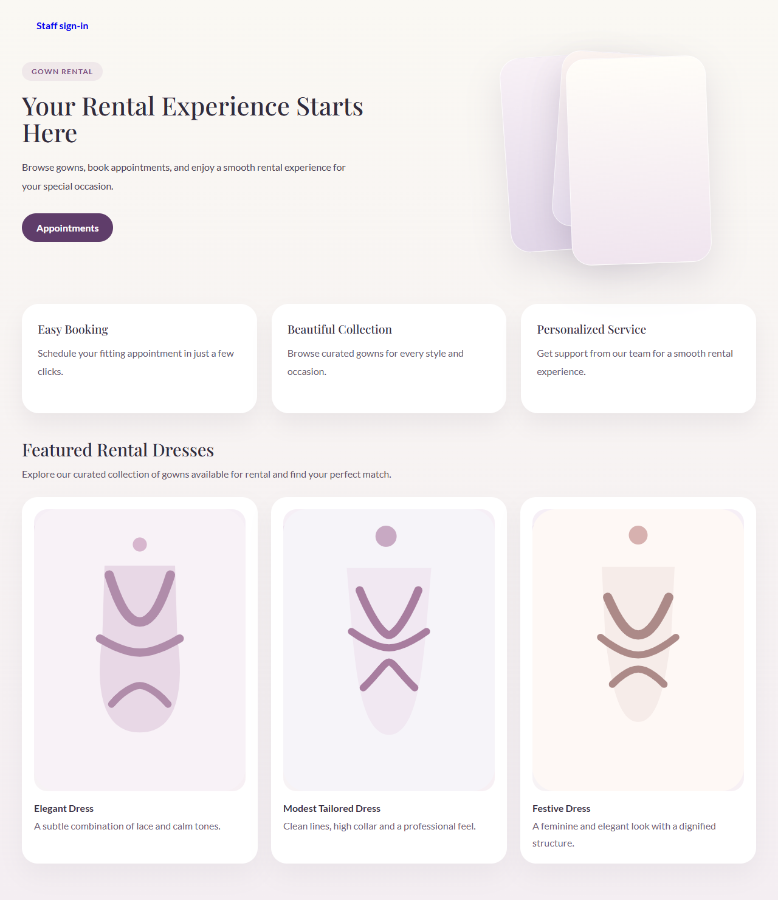
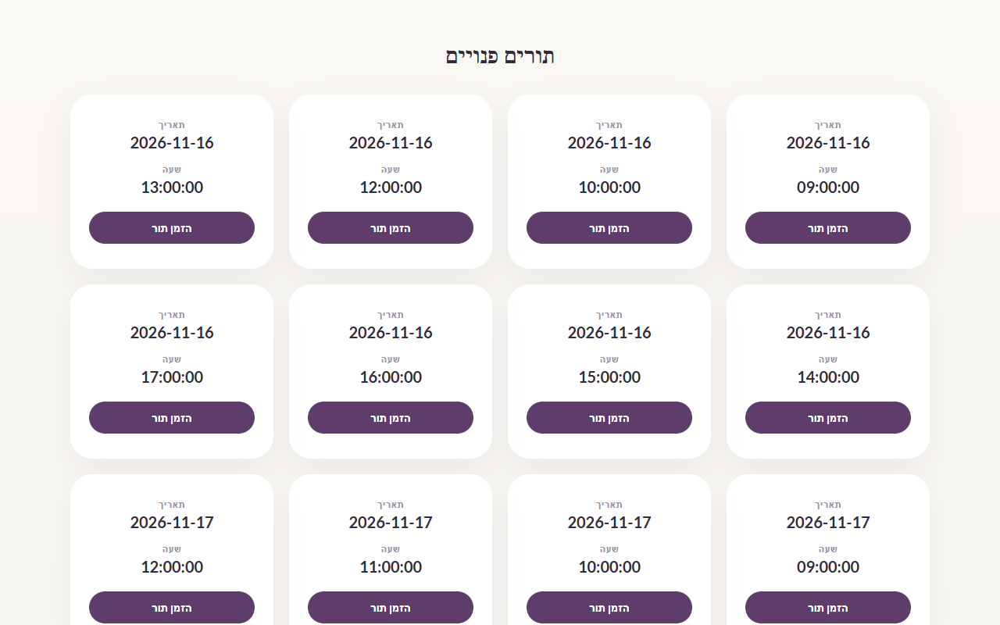
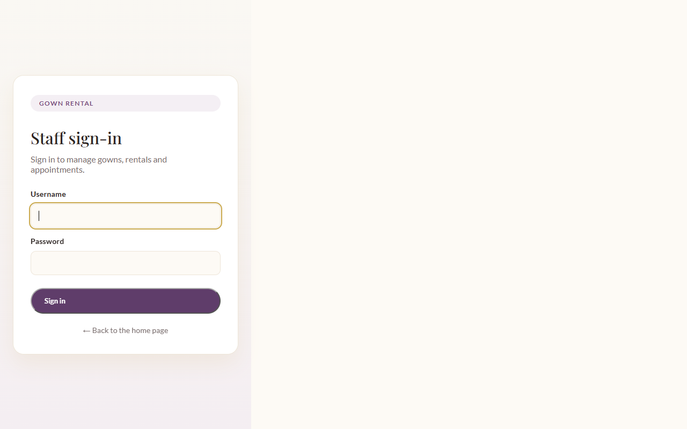
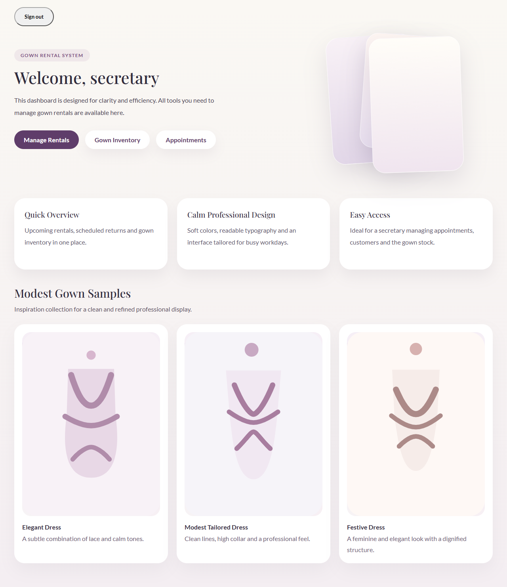
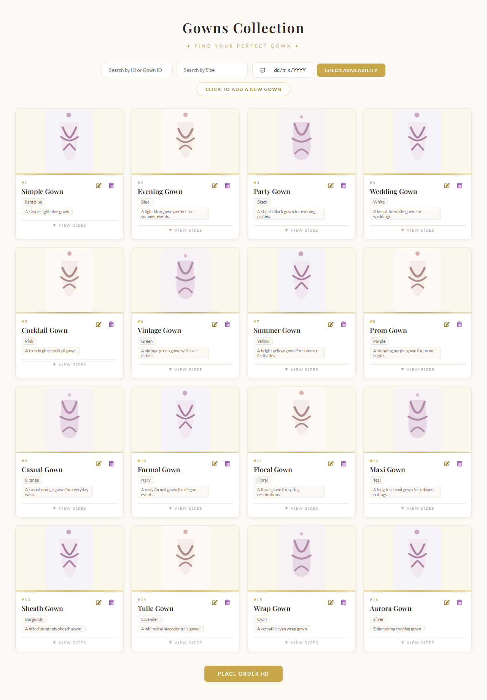
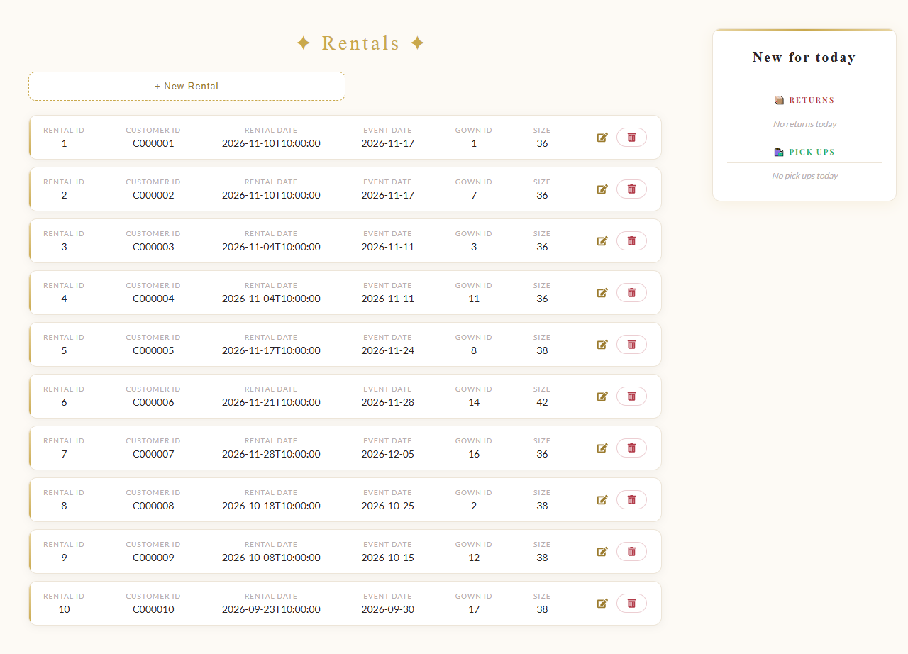
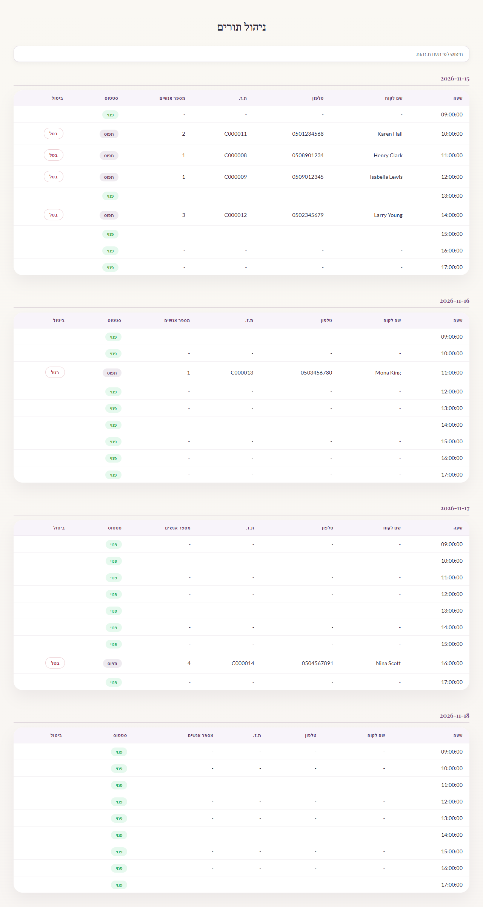

# GownRental

[](https://github.com/ayalaDaube/GownRental/actions/workflows/server.yml)
[](https://github.com/ayalaDaube/GownRental/actions/workflows/client.yml)

A full-stack web application for managing an evening-gown rental business: a gown catalog with per-size inventory, rentals with date-based availability, and fitting appointments, with separate views for customers and for the shop secretary.

It was built as a team study project for a client who rents out evening gowns for events, and is now being developed further toward a production-quality product (see [Status](#status-and-roadmap)).

## Screenshots

Taken from the running application with the fictional demo data.

| Home page | Booking a fitting (visitors) |
|---|---|
|  |  |

| Staff sign-in | Staff home |
|---|---|
|  |  |

| Gown catalog | Rentals and today's pick-ups and returns |
|---|---|
|  |  |



## Features

**Visitors (no account needed)**
- See the shop's home page
- Book a fitting appointment from the list of free slots

**Secretary (signs in)**
- Manage the gown inventory: add models and sizes, edit them, take a gown out of stock, delete gowns that were never rented
- Check which gowns are free on a chosen event date
- Place an order: pick several gowns for one customer and one event date, saved all together or not at all; new customers are registered on the way
- Create, update and delete rentals
- See which gowns are picked up and which come back today (events three days ahead and three days ago)
- See the appointments by day and cancel bookings

## Tech stack

| Layer | Technology |
|---|---|
| Client | React 18, TypeScript, Redux Toolkit, React Router 7, Axios (Create React App) |
| API | ASP.NET Core 8 Web API, Swagger / OpenAPI |
| Business logic | `Bl` class library |
| Data access | `Dal` class library, Entity Framework Core 8 |
| Database | SQL Server (LocalDB for development) |

## Architecture

```
Client (React)  ──HTTP/JSON──▶  Server (ASP.NET Core controllers)
                                      │
                                      ▼
                                 Bl  (business rules, validation, mapping to DTOs)
                                      │
                                      ▼
                                 Dal (EF Core services over DataManager DbContext)
                                      │
                                      ▼
                                SQL Server LocalDB
```

```
Client/            React application (src/pages, src/components, src/redux, src/services)
Server/
  Server/          Web API: controllers, Program.cs, configuration
  Bl/              Business logic services and DTOs
  Dal/             DbContext, entities, data services, EF Core migrations, demo data seeder
```

## API overview

Base URL in development: `https://localhost:7265` (Swagger UI at `/swagger`).

| Resource | Endpoints |
|---|---|
| Gowns | `GET /api/Gowns`, `GET /api/Gowns/groups`, `GET /api/Gowns/byDate?date=YYYY-MM-DD`, `GET /api/Gowns/{id}`, `POST /api/Gowns` (new model or new size), `PUT /api/Gowns/{id}` (a size), `PUT /api/Gowns/models/{modelId}`, `DELETE /api/Gowns/{id}`, `DELETE /api/Gowns/models/{modelId}` |
| Orders | `POST /api/Orders` (several gowns for one customer and event, all or nothing) |
| Rentals | `GET /api/Rentals`, `GET /api/Rentals/{id}`, `GET /api/Rentals/returning`, `GET /api/Rentals/renting`, `POST`, `PUT`, `DELETE /api/Rentals/{id}` |
| Appointments | `GET /api/Appointment`, `GET /api/Appointment/{id}`, `GET /api/Appointment/getByDate/{date}`, `GET /api/Appointment/getAvailableAppointments`, `POST`, `DELETE /api/Appointment/{id}` (cancel) |
| Auth | `POST /api/Auth/login`, `GET /api/Auth/me` |

### Business rules

- **Availability depends on the date.** Renting a gown never retires it. A gown is unavailable for an event when it is rented for another event less than four days away (three days before or after, for delivery and cleaning), or when it was taken out of stock (`isActive = false`).
- **A rental or an order is all or nothing.** The customer and gown must exist, the gown must be in stock and free on that date, and the event must not be in the past. If anything fails, nothing is saved.
- **Gowns with rental history cannot be deleted**; a model is deleted automatically when its last size is deleted.
- **Customers** are identified by an id or passport number of 5 to 9 letters or digits. A new customer needs a name and a phone number; details of an existing customer are never changed by a rental, an order or a public appointment booking.
- **Appointments** can be booked only while the slot is free and in the future; two people cannot book the same slot, even at the same moment.
- Ids of gowns and models are assigned by the server.

### Errors

Errors use the standard problem-details JSON (`application/problem+json`) with a `detail` message meant for the user: `400` invalid input, `401` not signed in, `403` wrong role, `404` not found, `409` conflict (for example a gown that is already rented), `429` too many login attempts. Anything unexpected is a generic `500` whose details are only written to the server log.

### Authentication

Staff sign in with a username and password and receive a signed [JWT](https://jwt.io/introduction). The client sends it as `Authorization: Bearer <token>` on every request.

- **Public (no sign-in):** `GET /api/Appointment/getAvailableAppointments` and `POST /api/Appointment`, so visitors can book a fitting, plus `POST /api/Auth/login`.
- **Everything else requires the `Secretary` role.** The API is secure by default: a new endpoint is protected unless it is explicitly marked `[AllowAnonymous]`.
- Passwords are stored only as salted hashes (ASP.NET `PasswordHasher`). Login attempts are rate limited per client address.
- In the Swagger UI, call `POST /api/Auth/login`, then press **Authorize** and paste the token to try protected endpoints.

**Development account.** In the Development environment the API creates one demo secretary on startup. Its username and password are defined under `Seed:Secretary` in `Server/Server/appsettings.Development.json`, together with a development-only signing key under `Jwt:Key`. These values exist for local use only.

**Production.** Never reuse the development values. Provide a random signing key of at least 32 characters outside of source control, for example with an environment variable (`Jwt__Key`) or `dotnet user-secrets`, and set `Cors:AllowedOrigins` to the real client address. The API refuses to start without a valid signing key. Demo data and the demo account are only created in Development.

**First start in production.** Outside Development the server applies the database migrations itself on startup (set `Database__MigrateOnStartup=false` to turn that off) and creates the shop's first secretary from two environment variables, so no password is written in a file:

```bash
Bootstrap__Username=owner
Bootstrap__Password=<at least 12 characters>
```

The account is created only while there are no accounts at all. At every later start the variables are ignored, so a restart never resets a password; remove them after the first start. Giving only one of the two, or a password shorter than 12 characters, stops the server with a clear message.

## Getting started

### Prerequisites

- [.NET 8 SDK](https://dotnet.microsoft.com/download/dotnet/8.0)
- [Node.js](https://nodejs.org/) 18 or newer
- SQL Server LocalDB (installed with Visual Studio, or with SQL Server Express)

### Database

No manual setup is needed. On startup in the Development environment the API creates a LocalDB database named `GownRental`, applies the EF Core migrations and fills it with fictional demo data: gowns in several sizes, customers, rentals due for pick-up and return, and free fitting appointments for the next three weeks. Dates are relative to today, so the demo is always populated. The seeder only adds what is missing, so restarting does not duplicate anything.

The connection string is read from `ConnectionStrings:DefaultConnection` in `Server/Server/appsettings.json`. To start over, drop the database:

```bash
cd Server
dotnet tool restore
dotnet ef database drop --project Dal --startup-project Server --context Dal.Models.DataManager
```

Changing the model? Add a migration (the `dotnet-ef` tool is pinned in `Server/.config/dotnet-tools.json`):

```bash
cd Server
dotnet ef migrations add <Name> --project Dal --startup-project Server --context Dal.Models.DataManager
```

### Run the API

```bash
cd Server/Server
dotnet run --launch-profile https
```

### Run the client

```bash
cd Client
npm ci
npm start
```

The client runs at http://localhost:3000 and calls the API at `https://localhost:7265`. To use another API address, copy `Client/.env.example` to `Client/.env.local` and change `REACT_APP_API_URL`. If the browser blocks the API certificate, trust the ASP.NET Core development certificate once with `dotnet dev-certs https --trust`.

Staff sign in at http://localhost:3000/login. Visitors can use the home page and appointment booking without an account.

### Code quality

The server builds without warnings and treats nullability warnings as errors (`Server/Directory.Build.props`). The client is TypeScript in strict mode, ESLint rejects explicit `any` outside tests, and `CI=true npm run build` fails on any warning. Data is filtered by the database, never by loading whole tables into memory.

## Testing

More than 600 automated tests protect the product. They are written from the **rules** of the business (what the shop needs, what a customer or the secretary expects), not from the code, and they check every limit on both sides: the last accepted value and the first refused one.

| | Tests | Coverage (lines / branches) | What they cover |
|---|---|---|---|
| Server | 468 | 96% / 88% | every route against the security rules (discovered automatically, so a new endpoint cannot be forgotten), forged and expired tokens, hostile and broken input, every field limit, double booking, all-or-nothing orders, customers, appointments, the demo data on every weekday, and constraints of the database itself |
| Client | 180 | 92% / 92% | the real HTTP client, the sign-in and routing of the whole app, and every screen followed through its flows (success, refusal, retry, double submit) with the Hebrew and English texts |

Bugs found this way were fixed in the code, never by changing the test. As a check on the tests themselves, key rules were broken on purpose (double booking allowed, past dates allowed, the token never sent, staff pages open to everyone...) and the suites failed each time.

```bash
cd Server
dotnet test            # API and business-rule tests, on an in-memory SQLite database

cd ../Client
npm test               # watch mode; add -- --watchAll=false for one run, or use npm run test:ci for coverage
```

The server tests start the real API in memory with its real security and database constraints; only the database engine differs (SQLite instead of SQL Server). Coverage of the server excludes generated migrations (`Server/coverage.runsettings`).

### Continuous integration

Two GitHub Actions workflows run on every push and pull request (`.github/workflows`):

- **Server:** build with warnings as errors, check that the migrations match the model, run the tests with coverage.
- **Client:** `npm ci`, lint (no warnings), type check, tests with a coverage threshold, production build.

A repository setting (Settings, then Branches, then a rule for `main`) can require these checks to be green before a pull request is merged. To run a workflow by hand, open the **Actions** tab, choose the workflow and press **Run workflow**. The same checks can be run locally with the commands in the workflow files. To skip a run for a commit that changes nothing in the code (for example a typo in a document), put `[skip ci]` in the commit message.

## Status and roadmap

The core flows work end to end. The goal is a polished product, in this order:

- [x] Single repository with the full history of all contributors
- [x] Connection string moved out of source code
- [x] Reproducible database: EF Core migrations and demo data
- [x] Real authentication (JWT) and role-based authorization instead of a client-side password
- [x] Bug fixes in deletion, order placement and availability logic
- [x] Code cleanup and strict typing in the client
- [x] Automated tests and continuous integration
- [x] Right-to-left layout for the Hebrew pages, gown pictures, screenshots
- [x] First-start provisioning for production (migrations and the first secretary)

## Team

| Contributor | Area |
|---|---|
| Ayala Daube ([@ayalaDaube](https://github.com/ayalaDaube)) | Gown catalog and inventory, availability by date, order cart, client/server project structure |
| Esther Joseph ([@EstherJoseph7](https://github.com/EstherJoseph7)) | Rentals, home pages, project integration |
| Naomi Britman | Fitting appointments |

The project began in [EstherJoseph7/GownRental-project](https://github.com/EstherJoseph7/GownRental-project); this repository keeps its complete commit history.

## License

[MIT](LICENSE)
